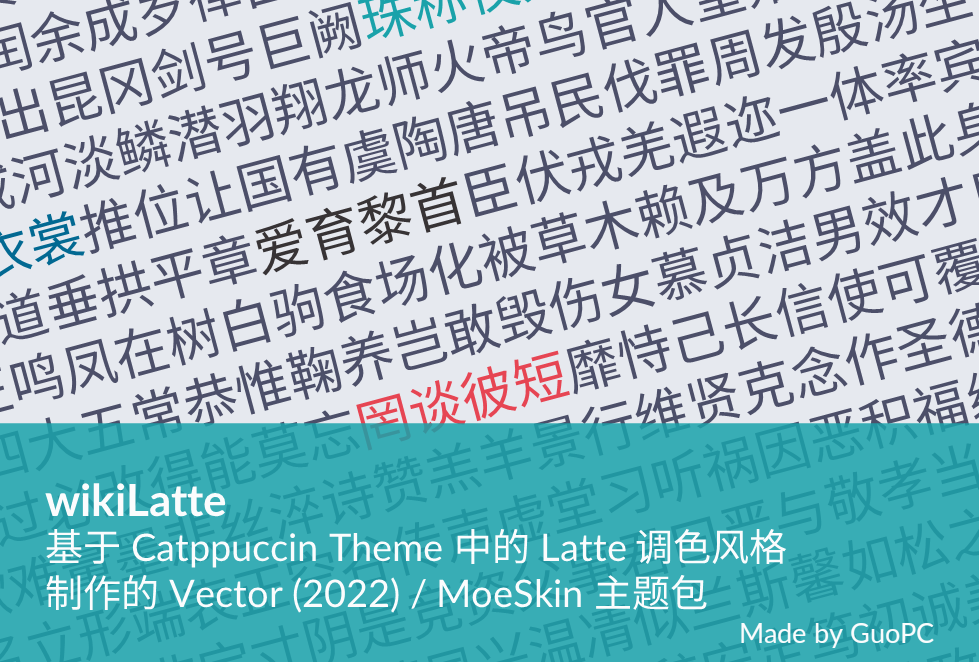

<h3 align="center">
  
</h3>

&nbsp;

  wikiLatte 是基于 <a href="https://catppuccin.com/">Catppuccin Theme</a> 中的 Latte 调色风格制作的一款用于 <a href="https://www.mediawiki.org/wiki/Special:MyLanguage/Skin:Vector/2022">Vector (2022)</a> / <a href="https://zh.moegirl.org.cn/Project:MoeSkin">MoeSkin</a> 皮肤的主题包。

  采用了 Latte 中的绿—蓝系列色作为主要配色，并进行了一定调整。 

&nbsp;

  

&nbsp;

  wikiLatte is a theme for <a href="https://www.mediawiki.org/wiki/Special:MyLanguage/Skin:Vector/2022">Vector (2022)</a> / <a href="https://zh.moegirl.org.cn/Project:MoeSkin">MoeSkin</a> based on Latte flavor in <a href="https://catppuccin.com/">Catppuccin Theme</a>.

  With colors from green to blue in Latte, the theme made some adjustments for convenience of use. 

&nbsp;

  

